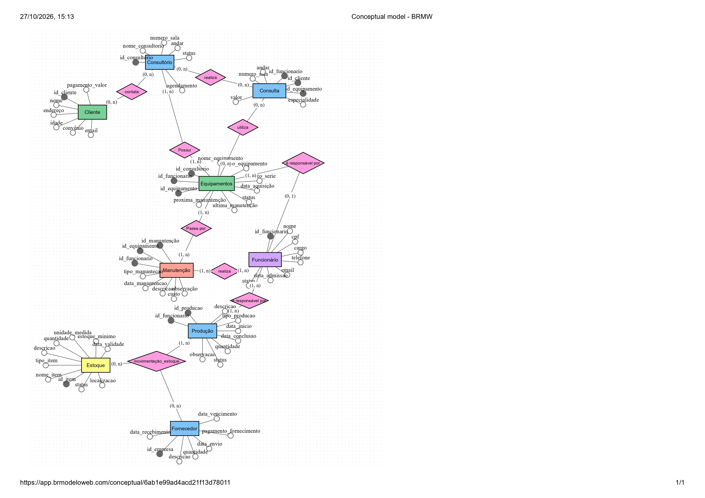

# 🦷 Odontologia Sasaki — Sistema de Gestão de Banco de Dados
> **Entrega 2 — Modelo Lógico, Implementação Física, Consultas SQL e Dashboard**

Projeto acadêmico desenvolvido para a disciplina de **Banco de Dados**, com o objetivo de transformar o modelo conceitual desenvolvido na Entrega 1 em um banco de dados funcional para apoiar a gestão da **Odontologia Sasaki**.

---

## 👥 Integrantes


| Nome | RGM |
|---|---|
| **Letícia Valentim Reges** | `047369680` |
| **Juan Arthur Franco** | `47232099` |
| **Isadora Do Nascimento Takami** | `47108932` |
| **Pedro Cândido Pyramides Pinheiro** | `04669634` |

---

## 🏥 Sobre o projeto

A **Odontologia Sasaki** é uma clínica odontológica de médio porte, com aproximadamente **20 colaboradores** e cerca de **500 atendimentos mensais**.

Além dos atendimentos odontológicos, a clínica possui produção própria de:

- 🦷 Implantes
- 😬 Aparelhos ortodônticos
- 🖨️ Peças produzidas por impressão 3D
---
###  Evidências da Organização
* **Endereço:** R. Jardim Tamoio, 1089 - Conj. Res. José Bonifácio, São Paulo - SP, 08255-010
* **Google Maps:** [Acessar localização no Google Maps](https://maps.app.goo.gl/ALuZBqSGNaq6kBxy9)
* **Contato:** `Luduque@hotmail.com` | `+55 11 99001-2968`
* **CRO- Clinica: 025226**
* **CRO- DRA.Luana Sasaki: 104086**
<p align="center">
  
  
</p>
  
---
Na **Entrega 1**, foram identificados problemas relacionados à organização das informações, principalmente no controle de equipamentos, manutenção, estoque, produção e consultórios.

Nesta **Entrega 2**, o projeto evolui para uma estrutura de banco de dados relacional capaz de centralizar essas informações e contemplar também processos relacionados a pacientes, agenda, atendimentos, procedimentos, pagamentos, fornecedores e movimentações de estoque.

---

 ## 🎯 Objetivo

Desenvolver um banco de dados relacional que permita:

- Centralizar informações da clínica
- Controlar pacientes e atendimentos
- Gerenciar agendamentos
- Registrar procedimentos e tratamentos
- Controlar pagamentos
- Gerenciar equipamentos e manutenções
- Controlar materiais e estoque
- Registrar fornecedores e compras
- Acompanhar produção interna
- Registrar processos de esterilização
- Gerar informações para análise gerencial
- Apoiar a tomada de decisões por meio de consultas e indicadores

---

## 🧩 Problema identificado
As informações da clínica podem estar distribuídas entre planilhas, anotações e diferentes controles internos.

Essa situação dificulta:

- Localizar informações rapidamente
- Acompanhar equipamentos
- Identificar equipamentos em manutenção
- Controlar estoque
- Acompanhar compras
- Consultar histórico de manutenção
- Controlar atendimentos
- Analisar pagamentos
- Acompanhar produção
- Obter indicadores para tomada de decisão

A proposta do banco de dados é **centralizar essas informações e estabelecer relacionamentos entre os diferentes processos da clínica**.

---

# 🗂️ Estrutura do Banco de Dados

O banco foi desenvolvido utilizando **MySQL**.

### Principais entidades

```text
CONSULTORIO
FUNCIONARIO
PACIENTE
FORNECEDOR
MATERIAL
```

```text
EQUIPAMENTO
MANUTENCAO
AGENDAMENTO
ATENDIMENTO
PROCEDIMENTO
``` 
```text
ATENDIMENTO_PROCEDIMENTO
PLANO_TRATAMENTO
PLANO_PROCEDIMENTO
PAGAMENTO
COMPRA
```

```text
ITEM_COMPRA
MOVIMENTACAO_ESTOQUE
PRODUCAO
ITEM_PRODUCAO
ESTERILIZACAO
```

---

# 🔗 Relacionamentos principais

### Atendimento

```text
PACIENTE 1 ─── N ATENDIMENTO
FUNCIONARIO 1 ─── N ATENDIMENTO
CONSULTORIO 1 ─── N ATENDIMENTO
```

<!--### Agendamento

<!-- ISADORA — COMMIT 32: cria/documenta relacionamentos de agendamento

```text
PACIENTE 1 ─── N AGENDAMENTO
FUNCIONARIO 1 ─── N AGENDAMENTO
CONSULTORIO 1 ─── N AGENDAMENTO
```

### Equipamentos

<!-- ISADORA — COMMIT 33: cria/documenta relacionamentos de equipamentos 

```text
CONSULTORIO 1 ─── N EQUIPAMENTO
FUNCIONARIO 1 ─── N EQUIPAMENTO
EQUIPAMENTO 1 ─── N MANUTENCAO
```

### Procedimentos

<!-- ISADORA — COMMIT 34: documenta relacionamento N:N de procedimentos 

Como um atendimento pode possuir vários procedimentos e um procedimento pode aparecer em vários atendimentos, foi criada a entidade associativa:

```text
ATENDIMENTO N ─── N PROCEDIMENTO
              │
              ▼
   ATENDIMENTO_PROCEDIMENTO
```

### Estoque e compras

<!-- ISADORA — COMMIT 35: documenta relacionamentos de compras 

```text
FORNECEDOR 1 ─── N COMPRA
COMPRA 1 ─── N ITEM_COMPRA
MATERIAL 1 ─── N ITEM_COMPRA
```

### Produção

<!-- ISADORA — COMMIT 36: documenta relacionamento da produção 

```text
PRODUCAO N ─── N MATERIAL
            │
            ▼
      ITEM_PRODUCAO
```

---

# 🛠️ Tecnologias utilizadas

<!-- ISADORA — COMMIT 37: adiciona badges das tecnologias 


<!-- ISADORA — COMMIT 38: documenta as ferramentas utilizadas 

**Ferramentas:**

- MySQL Workbench
- BRModelo
- Git/GitHub
- Markdown
- Dashboard para visualização dos indicadores-->

## Requisitos do Sistema

### Requisitos Funcionais
- [x] Cadastrar, alterar e consultar equipamentos.
- [x] Registrar a localização física e o funcionário responsável.
- [x] Registrar manutenções preventivas e corretivas.
- [x] Permitir consulta ao histórico operacional completo.
- [x] Controlar movimentações (entrada/saída) de estoque.
- [x] Registrar equipamentos e peças produzidos internamente.
- [x] Informar status em tempo real *(Disponível, Em Manutenção, Inativo, Em uso)*.
- [x] Mapear o inventário individual por consultório.

### Requisitos Não Funcionais
* **Segurança:** Autenticação obrigatória para acesso às funcionalidades.
* **Usabilidade:** Interface intuitiva e de fácil operação no dia a dia.
* **Desempenho:** Respostas e consultas otimizadas.
* **Disponibilidade:** Acesso contínuo para suporte às rotinas operacionais.
* **Integridade:** Consistência nos dados, evitando inconsistências e duplicidades.
---
## 7. **Modelo Entidade-Relacionamento (DER) e NoSQL (BRMW)**
<p align="center">
  
</p>
<p align="center">
  
</p>

## Modelo no BRModelo

O modelo também pode ser visualizado diretamente no **BRModelo Web**:

<p align="center">

**[Visualizar modelo no BRModelo Web](https://app.brmodeloweb.com/publicview/6ab1f51fd4acd21f13d78167)**

</p>

## NoSQL

O modelo também pode ser visualizado de forma online:
<p align="center">

**[Visualizar modelo no BRMW Web](https://app.brmodeloweb.com/publicview/6ae0ed97b96b0b8504df666a)**

</p>
---

<!--# 🗄️ Implementação do Banco

<!-- ISADORA — COMMIT 39: documenta criação do banco 

O script SQL realiza a criação completa do banco:

```sql
CREATE DATABASE odontologia_sasaki;
```

<!-- ISADORA — COMMIT 40: documenta tabelas e chaves 

São implementados:

- Tabelas
- Chaves primárias
- Chaves estrangeiras
- Restrições de integridade

<!-- ISADORA — COMMIT 41: documenta validações e relacionamentos 

- Campos obrigatórios
- Valores padrão
- Restrições `UNIQUE`
- Restrições `CHECK`
- Relacionamentos
- Dados fictícios para testes

---

# 🔑 Integridade dos dados

<!-- ISADORA — COMMIT 42: adiciona documentação de integridade 

Foram utilizadas diferentes restrições para garantir a consistência das informações.

<!-- ISADORA — COMMIT 43: adiciona tabela de restrições 

| Restrição | Objetivo |
|---|---|
| `PRIMARY KEY` | Identificação única dos registros |
| `FOREIGN KEY` | Controle dos relacionamentos |
| `NOT NULL` | Garantia de preenchimento de campos obrigatórios |
| `UNIQUE` | Evitar registros duplicados |
| `CHECK` | Validação de determinadas condições |

---

# 📊 Consultas SQL

<!-- ISADORA — COMMIT 44: documenta consultas de atendimento 

O projeto possui consultas voltadas para análise e gerenciamento da clínica.

### 📅 Atendimentos

- Atendimentos realizados por período
- Situação dos atendimentos
- Procedimentos realizados

<!-- ISADORA — COMMIT 45: documenta consultas de estoque 

### 📦 Estoque

- Materiais disponíveis
- Materiais abaixo do estoque mínimo
- Movimentações de estoque

<!-- ISADORA — COMMIT 46: documenta consultas financeiras 

### 💰 Financeiro

- Receita
- Valores recebidos
- Formas de pagamento
- Média dos pagamentos

<!-- ISADORA — COMMIT 47: documenta consultas de equipamentos 

### 🛠️ Equipamentos

- Equipamentos por status
- Equipamentos em manutenção
- Custos de manutenção

<!-- ISADORA — COMMIT 48: documenta consultas de agenda 

### 📈 Agenda

- Agendamentos
- Agendamentos confirmados
- Cancelamentos

<!-- ISADORA — COMMIT 49: documenta consultas de produção e esterilização 

### 🏭 Produção

- Produções realizadas
- Tipos de produção
- Materiais utilizados

### 🧼 Esterilização

- Ciclos realizados
- Ciclos com falha

---

# 📋 Consultas de gerenciamento

<!-- ISADORA — COMMIT 50: adiciona tabela inicial das consultas G01-G06 

| Código | Consulta |
|---|---|
| **G01** | Atendimentos realizados por mês |
| **G02** | Materiais abaixo do estoque mínimo |
| **G03** | Receita por forma de pagamento |
| **G04** | Total recebido por mês |
| **G05** | Equipamentos em manutenção |
| **G06** | Equipamentos por status |

<!-- ISADORA — COMMIT 51: adiciona consultas G07-G12 

| Código | Consulta |
|---|---|
| **G07** | Agendamentos por status |
| **G08** | Média dos pagamentos |
| **G09** | Produção por tipo |
| **G10** | Custo de manutenção por equipamento |
| **G11** | Taxa de cancelamento |
| **G12** | Falhas em ciclos de esterilização | -->

---

# 🔎 Auditoria


Também foram criadas consultas de auditoria para verificar a consistência das informações e o cumprimento das regras de negócio.

```text
A01
A02
A03
A04
A05
```

```text
A06
A07
A08
A09
A10
```
As consultas auxiliam na identificação de:

- Equipamentos sem consultório
- Equipamentos em manutenção
- Problemas relacionados ao estoque
- Registros incompletos
- Situações incompatíveis com as regras de negócio -->

---

# 📊 Dashboard

O banco de dados também serve como base para um **dashboard gerencial**, permitindo transformar os dados armazenados em indicadores visuais.

### Indicadores 

#### 🦷 Atendimentos

- Total de atendimentos
- Atendimentos por período
- Situação dos atendimentos
- Procedimentos realizados

#### 📅 Agenda

- Total de agendamentos
- Agendamentos confirmados
- Cancelamentos
- Situação da agenda

<!-- PEDRO — COMMIT 94: adiciona indicadores financeiros

#### 💰 Financeiro

- Receita
- Valores recebidos
- Formas de pagamento
- Média dos pagamentos

<!-- PEDRO — COMMIT 95: adiciona indicadores de estoque 

#### 📦 Estoque

- Materiais disponíveis
- Materiais abaixo do mínimo
- Entradas e saídas
- Movimentações

<!-- PEDRO — COMMIT 96: adiciona indicadores de equipamentos 

#### 🛠️ Equipamentos

- Total de equipamentos
- Equipamentos por status
- Equipamentos em manutenção
- Custos de manutenção

<!-- PEDRO — COMMIT 97: adiciona indicadores de produção 

#### 🏭 Produção

- Produções realizadas
- Tipos de produção
- Materiais utilizados

---

# 👁️ Views do Dashboard

<!-- PEDRO — COMMIT 98: cria view de equipamentos 

Foram criadas views específicas para facilitar a utilização dos dados pelo dashboard:

```text
vw_dashboard_equipamentos
```

<!-- PEDRO — COMMIT 99: cria view de estoque 

```text
vw_dashboard_estoque
```

<!-- PEDRO — COMMIT 100: cria view financeira 

```text
vw_dashboard_financeiro
```

<!-- PEDRO — COMMIT 101: cria view de agenda 

```text
vw_dashboard_agenda
```

<!-- PEDRO — COMMIT 102: cria view de manutenção 

```text
vw_dashboard_manutencao
```

---

# 📐 Evolução do projeto

<!-- PEDRO — COMMIT 103: documenta evolução da Entrega 1 

O projeto foi desenvolvido em duas etapas:

```text
ENTREGA 1
   │
   ├── Levantamento do problema
   ├── Requisitos
   ├── Regras de negócio
   └── Modelo conceitual / DER
```

<!-- PEDRO — COMMIT 104: documenta evolução para Entrega 2 

```text
             │
             ▼
ENTREGA 2
   │
   ├── Modelo lógico
   ├── Modelo físico
   ├── Implementação MySQL
   ├── Dados de teste
   ├── Consultas SQL
   ├── Auditoria
   ├── Views
   └── Dashboard
```

---

# 📌 Regras de negócio

<!-- PEDRO — COMMIT 105: documenta RN01 e RN02 

**RN01** — Todo equipamento deve estar cadastrado no sistema.

**RN02** — Todo equipamento deve estar associado a um consultório/localização.

<!-- PEDRO — COMMIT 106: documenta RN03 e RN04 

**RN03** — Toda manutenção deve estar relacionada a um equipamento.

**RN04** — Equipamentos em manutenção não devem ser considerados disponíveis para utilização.

<!-- PEDRO — COMMIT 107: documenta RN05 e RN06 

**RN05** — Toda movimentação de saída de estoque deve ser registrada.

**RN06** — A produção interna deve possuir registro dos materiais utilizados.

<!-- PEDRO — COMMIT 108: documenta expansão das regras 

A Entrega 2 também amplia o controle para pacientes, atendimentos, procedimentos, pagamentos, compras, fornecedores e esterilização. -->

---

# 🧪 Dados de teste

Os dados utilizados no banco são **fictícios** e foram criados exclusivamente para fins acadêmicos.

<!-- JUAN — COMMIT 66: documenta testes básicos 

Eles permitem testar:

- `INSERT`
- `SELECT`
- `UPDATE`
- `DELETE`
- `JOIN`

<!-- JUAN — COMMIT 67: documenta testes de integridade 

- Relacionamentos
- Regras de integridade
- Consultas gerenciais
- Auditorias
- Indicadores do dashboard

---

# 🔄 Operações SQL

<!-- JUAN — COMMIT 68: adiciona documentação de INSERT 

O projeto contempla as principais operações de manipulação de dados.

### INSERT

```sql
INSERT INTO ...
```

<!-- JUAN — COMMIT 69: adiciona documentação de SELECT 

### SELECT

```sql
SELECT ...
FROM ...
```

<!-- JUAN — COMMIT 70: adiciona documentação de UPDATE 

### UPDATE

```sql
UPDATE ...
SET ...
WHERE ...
```

<!-- JUAN — COMMIT 71: adiciona documentação de DELETE 

### DELETE

```sql
DELETE FROM ...
WHERE ...
```

<!-- JUAN — COMMIT 72: documenta operadores de consulta 

Também são utilizadas operações como:

```text
JOIN
GROUP BY
ORDER BY
COUNT
SUM
AVG
CASE
WHERE
HAVING
```

---

# 🤖 Uso de Inteligência Artificial

<!-- JUAN — COMMIT 73: documenta uso de IA 

A Inteligência Artificial foi utilizada como **ferramenta de apoio** durante o desenvolvimento do projeto.

<!-- JUAN — COMMIT 74: documenta atividades realizadas com IA 

Entre as atividades realizadas com auxílio de IA:

- Organização das ideias
- Estruturação dos requisitos
- Revisão da modelagem
- Apoio na elaboração das consultas SQL

<!-- JUAN — COMMIT 75: complementa documentação do uso de IA 

- Revisão do código
- Organização da documentação
- Estruturação do README
- Sugestões para apresentação dos dados

<!-- JUAN — COMMIT 76: adiciona transparência sobre decisões da equipe 

As decisões finais sobre a modelagem, regras de negócio e implementação foram analisadas e ajustadas pela equipe.

---

# 📁 Estrutura do repositório

<!-- JUAN — COMMIT 77: cria documentação da estrutura do repositório 

```text
odontologia-sasaki/
│
├── README.md
│
├── banco/
│   └── odontologia_sasaki_entrega_2_corrigido.sql
```

<!-- JUAN — COMMIT 78: adiciona estrutura de modelos 

```text
├── modelo/
│   ├── DER/
│   └── Modelo_Logico/
```

<!-- JUAN — COMMIT 79: adiciona estrutura do dashboard 

```text
├── dashboard/
│   ├── consultas/
│   └── views/
```

<!-- JUAN — COMMIT 80: adiciona estrutura de documentos 

```text
└── documentos/
    └── Entrega_2/
```

---

# 🚀 Como executar

<!-- JUAN — COMMIT 81: documenta instalação do MySQL 

### 1. Instale o MySQL

Utilize uma versão compatível com o script SQL.

<!-- JUAN — COMMIT 82: documenta MySQL Workbench 

### 2. Abra o MySQL Workbench

Crie ou utilize uma conexão com o servidor MySQL.

<!-- JUAN — COMMIT 83: documenta execução do script 

### 3. Execute o script

Abra o arquivo:

```text
banco/odontologia_sasaki_entrega_2_corrigido.sql
```

Execute o script completo.

<!-- JUAN — COMMIT 84: documenta seleção do banco 

### 4. Selecione o banco

```sql
USE odontologia_sasaki;
```

<!-- JUAN — COMMIT 85: documenta verificação das tabelas 

### 5. Verifique as tabelas

```sql
SHOW TABLES;
```

<!-- JUAN — COMMIT 86: documenta execução das consultas 

### 6. Execute as consultas

Teste as consultas de gerenciamento e auditoria disponíveis no script SQL.

---

# 📈 Resultado esperado

<!-- PEDRO — COMMIT 109: documenta resultado esperado 

A implementação permite centralizar os principais processos da clínica.

### Fluxo de atendimento

<!-- PEDRO — COMMIT 110: documenta fluxo de atendimento 

```text
PACIENTE
   ↓
AGENDAMENTO
   ↓
ATENDIMENTO
   ↓
PROCEDIMENTO
   ↓
PAGAMENTO
```

### Controle de equipamentos

<!-- PEDRO — COMMIT 111: documenta fluxo de equipamentos

```text
CONSULTORIO
   ↓
EQUIPAMENTO
   ↓
MANUTENCAO
```

### Controle de estoque

<!-- PEDRO — COMMIT 112: documenta fluxo de estoque 

```text
FORNECEDOR
   ↓
COMPRA
   ↓
MATERIAL
   ↓
ESTOQUE
```

### Produção

<!-- PEDRO — COMMIT 113: documenta fluxo de produção 

```text
PRODUCAO
   ↓
ITEM_PRODUCAO
   ↓
MATERIAL
```

---

# 🎓 Conclusão

<!-- PEDRO — COMMIT 114: documenta conclusão da Entrega 2 

A **Entrega 2** representa a evolução do projeto desenvolvido na Entrega 1, transformando o modelo conceitual em uma implementação relacional utilizando **MySQL**.

<!-- PEDRO — COMMIT 115: documenta benefícios da solução 

A solução busca centralizar informações, melhorar a rastreabilidade dos processos e disponibilizar dados para análise e tomada de decisão.

<!-- PEDRO — COMMIT 116: documenta integração do projeto 

A integração entre **Banco de Dados + SQL + Auditoria + Views + Dashboard** permite transformar registros operacionais em informações úteis para a gestão da **Odontologia Sasaki**.

---

# 👩‍💻 Projeto acadêmico

<!-- PEDRO — COMMIT 117: adiciona identificação acadêmica 

**Odontologia Sasaki — Sistema de Gestão de Banco de Dados**

**Curso:** Análise e Desenvolvimento de Sistemas — UNICID  
**Disciplina:** Banco de Dados  
**Entrega:** 2 — Modelo Lógico, Implementação, Consultas e Dashboard

<!-- PEDRO — COMMIT 118: adiciona encerramento do README 

---

⭐ **Projeto desenvolvido para fins acadêmicos.**
